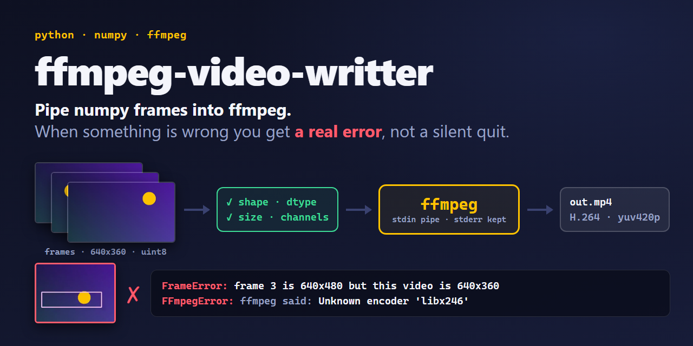
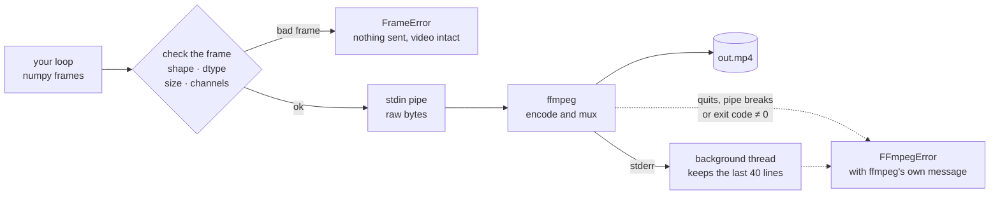

<p align="center"></p>

# FFmpeg Video Writter with Python

[](https://github.com/NatLee/ffmpeg-video-writter-with-python/actions/workflows/ci.yml)
[](https://www.python.org/)
[](https://ffmpeg.org/)
[](./LICENSE)

Write numpy frames to a video with ffmpeg, and get a real Python error when something is wrong.
Pipe frames into ffmpeg by hand and every mistake looks the same: a frame of the wrong size, a
float array, an odd width or a typo in an option all end with ffmpeg quitting, a broken pipe and
an empty or garbled file. This library checks every frame before it reaches ffmpeg, keeps
ffmpeg's error log, and raises an exception that tells you what happened and how to fix it. It
also picks settings that make files play everywhere. One file, and the only dependency is numpy.

It started out of frustration: OpenCV's `VideoWriter` kept saving a 6 KB file with no frames in
it, because one frame had a different size and nothing said so. Doing it with ffmpeg directly
was not much better: ffmpeg just quit without a word.

## Install

You need ffmpeg (which includes ffprobe) on your PATH:

| System | Command |
|---|---|
| Debian / Ubuntu | `sudo apt install ffmpeg` |
| macOS | `brew install ffmpeg` |
| Windows | `winget install ffmpeg` |
| conda | `conda install -c conda-forge ffmpeg` |

Then install the library from GitHub:

```bash
pip install git+https://github.com/NatLee/ffmpeg-video-writter-with-python
```

Or copy [`ffmpeg_video_writer.py`](ffmpeg_video_writer.py) into your project. It is a single file
and only needs numpy.

## Quick start

```python
import numpy as np
from ffmpeg_video_writer import VideoWriter

with VideoWriter("bouncing_ball.mp4", fps=30) as video:  # H.264 + yuv420p: plays everywhere
    for i in range(90):
        frame = np.zeros((360, 640, 3), np.uint8)       # height x width x RGB, uint8
        x = 40 + abs((i * 2 / 30) % 2 - 1) * 560
        frame[160:200, int(x) - 20:int(x) + 20] = (255, 196, 0)
        video.write(frame)
```

That's it. The `with` block closes the file, and if ffmpeg failed, closing raises `FFmpegError`
with ffmpeg's own message. [`examples/quick_start.py`](examples/quick_start.py) draws a round
ball and also makes this GIF:

<p align="center"></p>

## Examples

### Frames from OpenCV (BGR)

OpenCV stores colours as blue, green, red. Say so, or every face in your video turns blue:

```python
import cv2
from ffmpeg_video_writer import VideoWriter

capture = cv2.VideoCapture("bouncing_ball.mp4")
with VideoWriter("gray_edges.mp4", fps=30, pixel_format="bgr24") as video:
    while True:
        ok, frame = capture.read()
        if not ok:
            break
        edges = cv2.Canny(frame, 100, 200)
        video.write(cv2.cvtColor(edges, cv2.COLOR_GRAY2BGR))
capture.release()
```

Other frame layouts: `"rgb24"` (the default: numpy, Pillow, imageio, matplotlib), `"rgba"`,
`"bgra"` and `"gray"` (a plain `height x width` array works).

### Read a video, change it, keep the sound

`VideoReader` gives you the frames of a file as numpy arrays (RGB by default, and writable, so
you can draw on them). `audio=` copies the soundtrack of another file into the output.

```python
from ffmpeg_video_writer import VideoReader, VideoWriter

with VideoReader("input.mp4") as reader, VideoWriter(
    "inverted.mp4", fps=reader.fps, audio="input.mp4"
) as writer:
    print(f"{reader.width}x{reader.height}, about {reader.frame_count} frames")
    for frame in reader:
        writer.write(255 - frame)
```

Pass `fps=` to `VideoReader` to resample (for example `VideoReader("input.mp4", fps=10)`).

### Quality, size and codec

```python
from ffmpeg_video_writer import VideoWriter

VideoWriter("small.mp4", fps=30, crf=28)                  # x264 quality: 18 ≈ lossless, 23 default, 28 small
VideoWriter("fixed_rate.mp4", fps=30, bitrate="2M")       # target bitrate instead of crf
VideoWriter("smaller.mp4", fps=30, codec="libx265", crf=28, output_args=["-tag:v", "hvc1"])
VideoWriter("web.mp4", fps=30, output_args=["-preset", "slow", "-movflags", "+faststart"])
VideoWriter("ffmpeg_decides.avi", fps=30, codec=None, output_pixel_format=None)
```

`output_args` goes straight to ffmpeg, so any output option works there. Odd frame sizes are
padded with one black row or column (yuv420p needs even sizes); `pad_to_even=False` turns that
off, and `writer.output_size` tells you what was stored.

### A GIF for your README

```python
from ffmpeg_video_writer import to_gif

to_gif("bouncing_ball.mp4", "bouncing_ball.gif", fps=15, width=320)
```

`to_gif` builds a colour palette from the video first, so GIFs look clean and stay small.

### Check a file

```python
from ffmpeg_video_writer import probe

info = probe("bouncing_ball.mp4")
print(info.width, info.height, info.fps, info.frames, info.codec, info.pixel_format)
# 640 360 30.0 90 h264 yuv420p
```

## What the errors look like

[`examples/show_errors.py`](examples/show_errors.py) makes the classic mistakes on purpose. This
is its real output (shortened):

```text
--- A frame with a different size halfway through
FrameError: frame 1 is 640x480 but this video is 640x360 (set by the first frame). Every frame
must have the same size; resize or crop it to 640x360 first.

--- Float frames scaled 0..1 (astype(uint8) would make them black)
FrameError: frame 0 has dtype float64 and looks scaled to 0..1 (min 0.5, max 0.5); uint8 would
make it black. Convert it with (frame * 255).round().astype(np.uint8).

--- An RGBA frame for an RGB video
FrameError: frame 0 has 4 channel(s) but pixel_format='rgb24' expects 3. For 4-channel frames
use pixel_format='rgba'.

--- A typo in the codec name
FFmpegError: ffmpeg stopped reading at frame 1 (exit code 8, writing /tmp/tmpd2lfecag/demo.mp4).
ffmpeg said:
  [vost#0:0 @ 0x559f2ac14140] Unknown encoder 'libx246'
  [vost#0:0 @ 0x559f2ac14140] Error selecting an encoder
  Error opening output file /tmp/tmpd2lfecag/demo.mp4.
  Error opening output files: Encoder not found
command: /usr/bin/ffmpeg -hide_banner -loglevel error -nostats -y -f rawvideo -pix_fmt rgb24
  -s 640x360 -framerate 30 -i pipe:0 -c:v libx246 -pix_fmt yuv420p /tmp/tmpd2lfecag/demo.mp4

--- ffmpeg is not installed
FFmpegNotFoundError: Cannot find 'ffmpeg-not-installed'. Install ffmpeg (it includes ffprobe)
and make sure it is on your PATH, or pass the full path with ffmpeg='/path/to/ffmpeg'. ...
```

A `FrameError` is raised before anything is sent, so the video written so far stays intact and
you can keep writing. An `FFmpegError` carries `.returncode`, `.stderr` and `.cmd` if you want to
log them.

## How it works



The first frame starts ffmpeg with the frame size, pixel format and frame rate on its command
line. Each later frame is checked against that, then written to ffmpeg's standard input as raw
bytes. ffmpeg's error log is read in the background all the time. When ffmpeg exits early, when
a write hits a broken pipe, or when `close()` sees a non-zero exit code, that log goes into the
exception.

## ffmpeg pitfalls this handles

**Why ffmpeg "quits silently".** When you pipe frames in, ffmpeg's error message goes to its
stderr. In a notebook, a GUI app or a background job nobody sees it. Python only notices on the
next write, as a bare `BrokenPipeError` (on Windows, `OSError: [Errno 22] Invalid argument`), or
never, if nobody checks the exit code. Here the log is kept and the exit code is always checked.

**Pipe buffering and hangs.** A pipe holds only about 64 KiB. If you capture ffmpeg's stderr but
don't read it, ffmpeg fills it and stops forever. If you stop reading a decoding ffmpeg's output
and then wait for it, both sides wait forever. The writer reads stderr on a background thread;
`VideoReader.close()` stops ffmpeg instead of waiting for it, so you can stop reading at any frame.

**Raw frames have no size.** `rawvideo` is just bytes. ffmpeg cuts them into frames using the
width and height you gave it at the start. One frame of a different size shifts everything
after it: a garbled video, and no error. Every frame is compared with the first one (or `size=`).

**Data types.** `frame.astype(np.uint8)` never complains: floats in 0..1 become 0 (a black
video), and 300 wraps around to 44. Frames that are not uint8 are accepted only when no value
would change; otherwise you get a `FrameError` that says how to convert.

**Colour order.** OpenCV gives you BGR, almost everything else RGB, and ffmpeg can't tell the
difference: red and blue swap. Use `pixel_format="bgr24"` for OpenCV frames.

**Pixel formats.** Given RGB input, ffmpeg picks 4:4:4 colour for H.264 ("High 4:4:4
Predictive"), which browsers, QuickTime and many phones refuse to play. The writer stores
`yuv420p` by default, the format every player supports.

**Odd sizes.** yuv420p keeps colour at half resolution in both directions, so the width and
height must be even. libx264 stops with `width not divisible by 2`. The writer pads odd sizes by
one black pixel.

**Frame rate of raw input.** Raw frames carry no timing, so ffmpeg assumes 25 fps unless told
otherwise. The writer always passes `fps`. (The 2020 version of this project had exactly this
bug: frames sampled at 27 fps played back at 25.)

**The overwrite question.** Without `-y`, ffmpeg asks "Overwrite? [y/N]" on its standard input,
which is your frame pipe. The writer always overwrites, like OpenCV's `VideoWriter`.

**Rotated phone videos.** ffmpeg turns frames upright while decoding, so a portrait video
decodes as 1080x1920 although its stream says 1920x1080. `VideoReader` and `probe()` read the
rotation and report the size you actually get.

## Upgrading from `FFmpegVideoWritter`

The original class still works, with the same arguments and methods:

```python
from FFmpegVideoWritter import FFmpegVideoWritter

ffvw = FFmpegVideoWritter("input.mp4", "result.mp4")  # fps=27 by default
while True:
    frame = ffvw.get_frame()  # RGB numpy array, None at the end
    if frame is None:
        break
    ffvw.write(frame[::2, ::2])  # half size
ffvw.close()
ffvw.output_to_gif()  # result.mp4.gif
```

It now runs on `VideoReader` and `VideoWriter`, so it raises the same clear errors, and it no
longer has the bugs of the 2020 version: the output plays at the requested fps instead of 25,
the last part of the input is no longer cut off, `close()` does not hang when frames are left
unread, `output_to_gif()` works without a name, gray input works, and mkv/webm inputs open. It
can also be used with `with`.

> **Default change in 1.0.0 (approved by the maintainer):** `FFmpegVideoWritter` now stores
> yuv420p, like `VideoWriter`, so its .mp4 files play in browsers, QuickTime and phones. Before,
> ffmpeg picked 4:4:4 colour for RGB frames ("High 4:4:4 Predictive"), which many players
> refuse. yuv420p needs even sizes, so a frame with an odd width or height gets one extra black
> column or row (319x239 is stored as 320x240). The encoder is still the one ffmpeg picks for the
> file extension (H.264 for .mp4, mpeg4 for .avi, VP9 for .webm), with the old
> `-qscale:v 0.01` quality option.

The demo that used to be `main.py` is now
[`examples/draw_rectangles.py`](examples/draw_rectangles.py):

```bash
python examples/quick_start.py                 # makes bouncing_ball.mp4
python examples/draw_rectangles.py --show      # half size, random rectangles, preview window
```

<p align="center"></p>

## API

| Name | What it does |
|---|---|
| `VideoWriter(path, fps=30, *, size=None, pixel_format="rgb24", codec="libx264", crf=None, bitrate=None, output_pixel_format="yuv420p", pad_to_even=True, audio=None, output_args=(), ffmpeg="ffmpeg")` | `write(frame)`, `close()`, `with`; `size`, `output_size`, `frames_written`, `command` |
| `VideoReader(path, fps=None, *, pixel_format="rgb24", ffmpeg="ffmpeg")` | `read()` (None at the end), iteration, `close()`, `with`; `width`, `height`, `fps`, `frame_count`, `info` |
| `probe(path, *, ffmpeg="ffmpeg")` | `VideoInfo(width, height, fps, duration, frames, codec, pixel_format, has_audio)` |
| `to_gif(src, dst, *, fps=None, width=None, ffmpeg="ffmpeg")` | Palette-based GIF; returns `dst` |
| `FrameError` (a `ValueError`) | The frame doesn't fit: shape, size, channels or dtype |
| `FFmpegError` (a `RuntimeError`) | ffmpeg or ffprobe failed; has `.returncode`, `.stderr`, `.cmd` |
| `FFmpegNotFoundError` (an `FFmpegError`) | ffmpeg or ffprobe is not installed |

Every function takes `ffmpeg="/path/to/ffmpeg"` if ffmpeg is not on your PATH; ffprobe is looked
up in the same folder.

## Run the tests

The tests need a real ffmpeg, so they run in Docker:

```bash
docker build -f tests/Dockerfile -t ffmpeg-video-writter-test .
docker run --rm ffmpeg-video-writter-test
```

Add `--build-arg PYTHON=3.8` to test with Python 3.8 and the ffmpeg 5.1 from Debian 12. CI runs
Python 3.8, 3.12 and 3.14 in Docker, plus Python 3.12 on Windows.

## License

[MIT](LICENSE)
